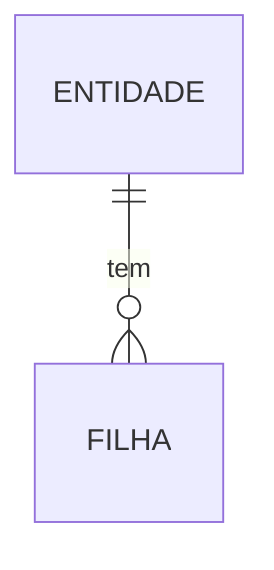
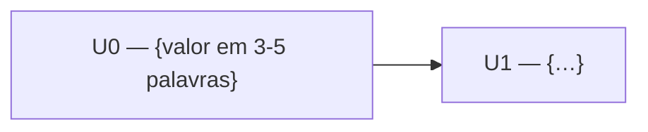

# {Feature} — Guia de Validação (leitor humano)

> **O que é.** O insumo da aprovação do pacote no portão final do `/tasks`: a pessoa que
> aprova lê **este guia**, não os três documentos. Ele resume a intenção, a modelagem, a
> decomposição, as decisões que ela assinou e a prontidão para o loop autônomo.
>
> **Regra de ouro: derivado, nunca fonte.** Tudo aqui vem de `spec.md`, `plan.md` e
> `tasks.md` da feature. Nada novo nasce no guia. Documento-fonte mudou → regenerar o
> guia (e republicar no mesmo endereço) antes de aprovar.
>
> **Publicação.** Quando a sessão tem publicação de páginas (Artifacts do Claude), o
> guia vira uma página HTML (diagramas Mermaid renderizados) e
> `docs/specs/{feature}/guia-de-validacao.md` guarda só o **link + data**. Sem essa
> ferramenta, o guia é o próprio `guia-de-validacao.md` (Mermaid renderiza no GitHub e
> nos editores). Seções fora do footprint da feature são **omitidas**, não deixadas vazias.

---

## 1. A feature em 1 parágrafo

{O problema, quem é afetado, o que passa a funcionar. Sem jargão de implementação.} *(spec › visão)*

## 2. Definições essenciais

| Termo | Significado nesta feature |
|---|---|
| {termo} | {definição} |

*(spec › glossário / Decisões Fechadas)*

## 3. Modelo de dados *(se toca persistência)*

{1 linha por mudança de schema: tabela/coleção nova, coluna nova, índice, restrição.} *(plan › modelo de dados)*

## 4. Fluxo principal — mapa de execução *(se toca domínio/API)*

Linha do tempo por passo. Cada passo numa de três faixas — **usuário** (tela/ação),
**interno** (código deste projeto), **externo** (serviço de terceiros) — com:

- **chamada literal** (verbo + rota, ou nome do comando/evento);
- **grava**: onde persiste e o quê (tabela → campo → valor), em todo passo que persiste;
- **retorno**: o que volta, em toda ida a serviço externo;
- **ponto sem volta** marcado quando há efeito irreversível (cobrança, envio, exclusão).

Códigos de erro e siglas de tela não entram no corpo — vão para a referência rápida no fim. *(plan › contrato/fluxo)*

## 5. Permissões *(se toca autorização)*

| Ação | Quem pode | Onde é checado |
|---|---|---|
| {ação} | {papel} | {camada} |

## 6. Telas e fonte de design *(se toca UI)*

| Tela | Fonte de design | Fatia dona |
|---|---|---|
| {tela} | {protótipo: ferramenta/artefato/imagem · ou Design System · ou tela existente} | U«n» |

*(spec › Anatomia da Tela · tasks)*

## 7. Mapa das fatias

Nó = fatia + valor entregável; marcar os grupos paralelizáveis. *(tasks › grafo)*

## 8. Decisões que VOCÊ assinou

| # | Decisão | Opção escolhida | Implicação |
|---|---|---|---|
| D1 | {…} | {…} | {…} |

É o que se relê antes de aprovar: erro de regra de negócio que passou pela clarificação
só é pego aqui. *(spec › Decisões Fechadas e Diferidas)*

## 9. Prontidão para execução autônoma

- **Cobertura de entendimento**: «NN»% — {componentes < 100% em uma linha, ou "tudo fechado"}
- **Índice de execução autônoma**: «NN»% — previsão de quanto o loop segue sozinho
- **Paradas eliminadas antes do loop**: {lista curta: parada → como sumiu}
- **Top riscos de parada que sobraram**: {1–3, com a fatia onde moram}

*(tasks › Prontidão — a decomposição de cada número está lá)*

## 10. Como o loop vai rodar

| Definição | Resposta |
|---|---|
| Branch | {…} |
| Commit | {commit autônomo / staged} |
| Push | {sim / não} |
| Modo | {sequencial / multi-agente em G«n»} |
| Scan de segurança | {sim, esforço X / não} |

Aprovado o pacote, o `/execute` encadeia as fatias sem pedir ok entre elas e só para no
realmente bloqueante (bloqueio sem fatia liberada, watchdog, decisão de negócio não
fechada, ação destrutiva).

## 11. O que este guia NÃO cobre

- **Conformidade de código** — verificadores independentes e gates por fatia, por máquina.
- **Fidelidade visual** — conferida pelo loop contra a fonte de design de cada tela.
- **Regra de negócio errada que passou pela clarificação** — o guia só mitiga: a seção 8 existe para você reler o que assinou.

Validar este guia = validar **intenção, modelagem e decomposição**. O resto é verificado
por máquina e reportado por fatia no `tasks.md`.

---

**Referência rápida**: {códigos de erro, siglas, rotas — o que saiu do corpo do §4}
